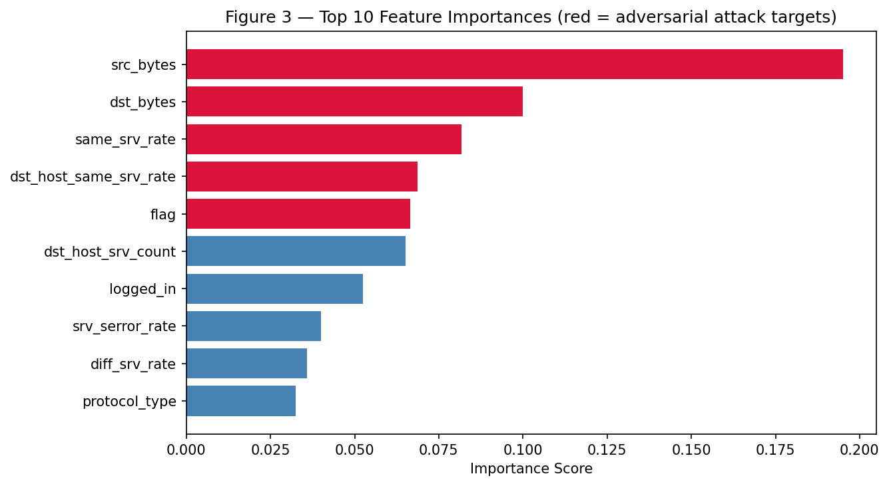
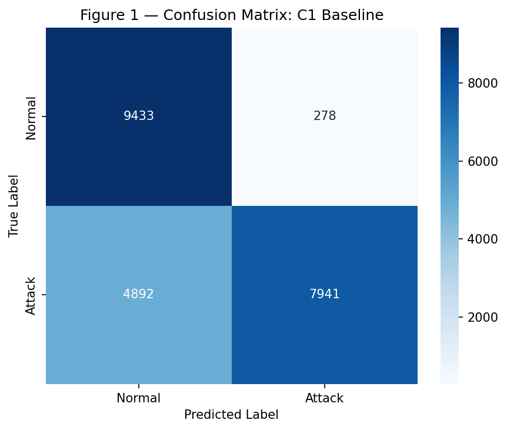
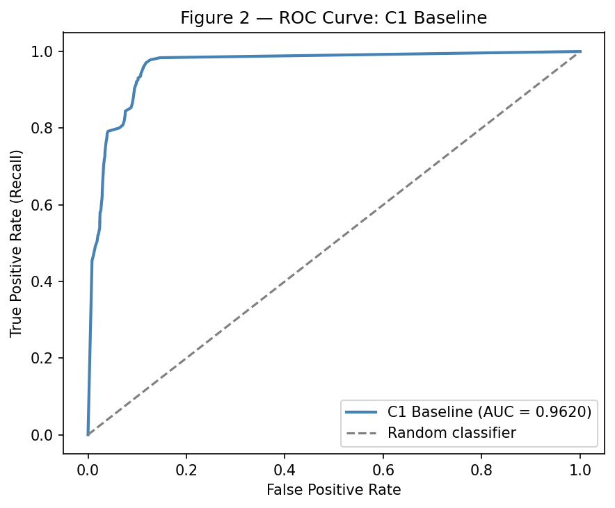
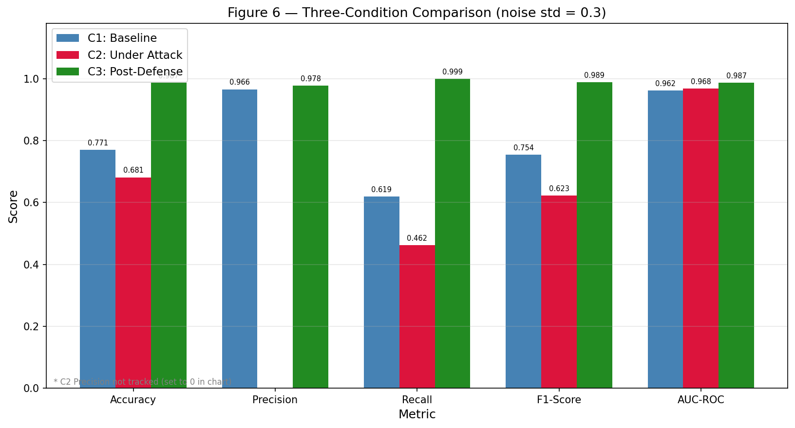
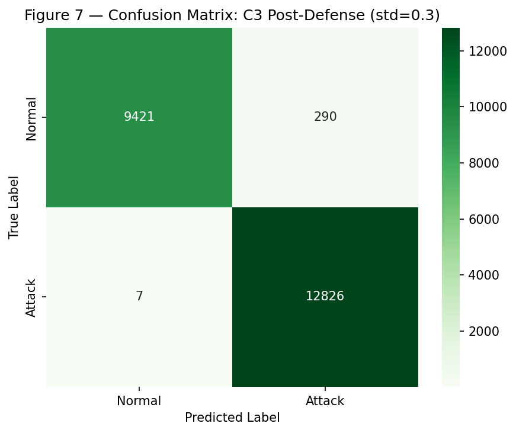
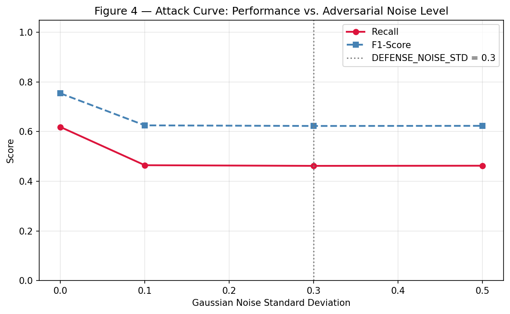
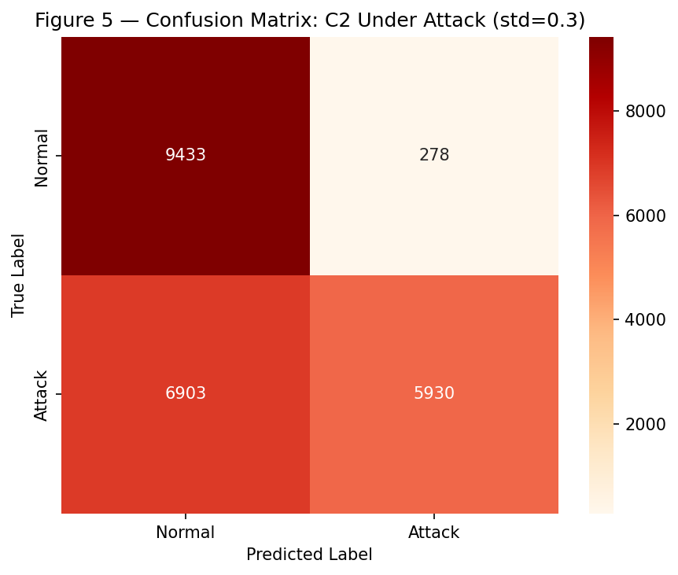
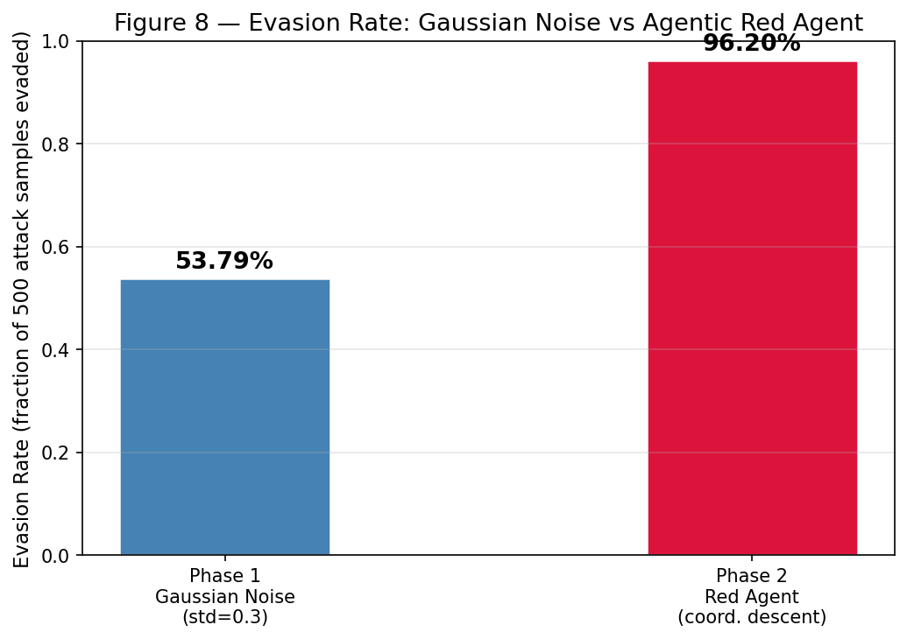
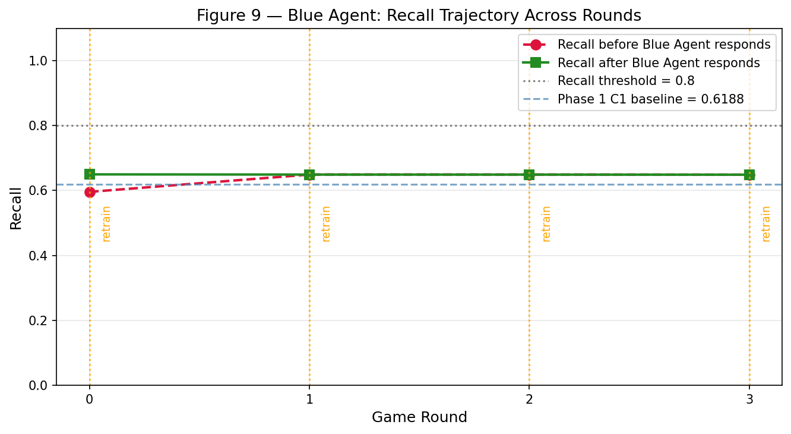
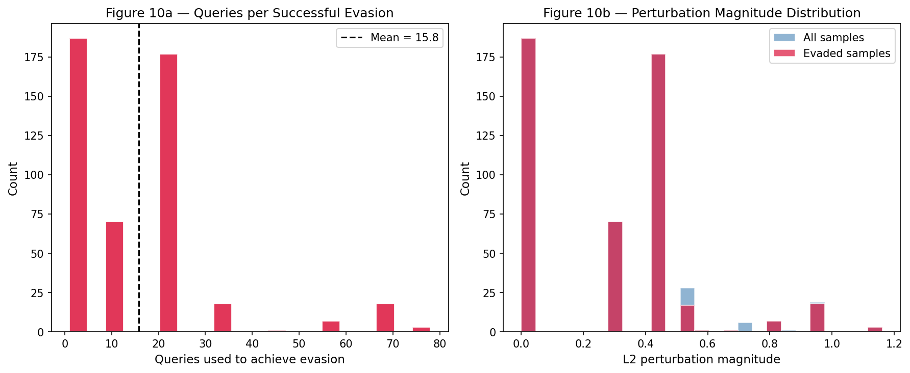

# Adaptive Adversarial Threat Detection and Defense Framework for Robust AI-Based Cybersecurity Systems

---

**Subject Code:** 21CSC601T — Case Study  
**Student Name:** Darpit Vyas  
**Roll Number:** RA2512023010026  
**Programme:** M.Tech Computer Science and Engineering  
**Guide:** Dr. Sundarrajan M.  
**Institution:** SRM Institute of Science and Technology  

---

## TABLE OF CONTENTS

1. Abstract
2. Introduction
3. Objectives
4. Problem Statements
5. Methodology
6. Case Scenarios
7. Discussion
8. Proposed Solution
9. Conclusion
10. References

---

## 1. ABSTRACT

Artificial intelligence-based intrusion detection systems (IDS) have demonstrated strong performance on standard network traffic benchmarks; however, their resilience against adversarial manipulation — particularly for non-differentiable classifiers such as Random Forest — remains comparatively understudied. This case study evaluates the adversarial vulnerability of a Random Forest binary classifier trained on the NSL-KDD dataset and examines the effectiveness of adversarial training as a defense mechanism, while extending the investigation to a fully agentic adversarial game in Phase 2. In Phase 1, a feature-space evasion attack was simulated by applying Gaussian noise (mean=0, std=0.3) to the five most important features — `src_bytes`, `dst_bytes`, `same_srv_rate`, `dst_host_same_srv_rate`, and `flag` — of attack-class test samples. The baseline classifier (C1) achieved accuracy of 0.7707, recall of 0.6188, and AUC-ROC of 0.9620; under adversarial attack (C2), recall dropped to 0.4621, a reduction of 0.1567. Following adversarial training (C3), recall recovered to 0.9995 and F1-score reached 0.9886, substantially exceeding the clean baseline across all metrics. In Phase 2, the experiment was extended into a four-round adversarial game: a black-box coordinate-descent RedAgent achieved an evasion rate of 96.20% against the undefended baseline — compared to 53.79% for random Gaussian noise — while an adaptive BlueAgent detected recall degradation and triggered on-demand retraining using vectorised coordinate-descent augmentation. Following the first retraining event, evasion dropped to 42.40%, demonstrating the effectiveness of matched-strategy adversarial defense in a dynamic multi-round setting. These results collectively establish that adversarial training provides full recovery and significant improvement beyond the clean baseline, and that adaptive, closed-loop defense can substantially reduce the advantage of intelligent attackers. This work contributes a controlled, end-to-end experimental evaluation to the comparatively understudied area of adversarial robustness for tree-based network intrusion detection systems.

---

## 2. INTRODUCTION

### 2.1 Background of Cybersecurity and AI-Based Intrusion Detection

The rapid expansion of networked systems has made intrusion detection a critical component of modern cybersecurity infrastructure. Organizations across industry verticals — including financial services, healthcare, energy, and government — rely on network security monitoring to identify unauthorized access, lateral movement, and data exfiltration in real time. Rule-based intrusion detection systems, while effective against known attack signatures, are unable to generalize to novel attack patterns and require continuous manual updating as the threat landscape evolves. This limitation has driven widespread adoption of machine learning-based IDS that learn discriminative patterns from labelled network traffic data, offering scalability and adaptability that deterministic rule systems cannot match [1].

Ensemble methods such as Random Forest have been particularly well-studied for this purpose. Comparative evaluations on the NSL-KDD benchmark dataset have consistently demonstrated that Random Forest classifiers achieve strong binary classification performance, distinguishing normal network traffic from attack traffic with high accuracy and precision [2]. These classifiers benefit from the dataset's inclusion of Denial of Service (DoS), Probe, Remote-to-Local (R2L), and User-to-Root (U2R) attack categories, providing a broad coverage of historical attack patterns. Despite these favourable benchmark results, standard evaluation methodology assumes that test-time inputs faithfully represent real network traffic without deliberate manipulation — an assumption that does not hold in adversarial deployment environments.

### 2.2 The Adversarial Machine Learning Threat

The vulnerability of machine learning models to adversarial manipulation was formally established by Szegedy et al. [3], who demonstrated that imperceptibly small structured perturbations to input samples could reliably cause misclassification in deep neural networks. This finding was extended by Goodfellow et al. [4], who proposed the Fast Gradient Sign Method (FGSM) and attributed adversarial vulnerability to the linearity of high-dimensional model decision boundaries. The implication — that small, deliberate perturbations to input features can shift samples across learned decision boundaries — applies across model architectures and is of direct relevance to security-critical classification tasks such as intrusion detection.

In the cybersecurity domain, the adversarial threat is operationally significant. An attacker who understands the feature representation of network traffic can craft packets or sessions whose feature vectors differ only slightly from legitimate attack traffic yet are misclassified as normal by a deployed classifier — a class of attack known as a test-time evasion attack [5]. Unlike poisoning attacks that target the training phase, evasion attacks exploit a deployed model and require no access to the training data or model internals if the attacker can observe the system's classification decisions. The practical consequence is a real-world detection rate substantially below what benchmarked performance suggests, with potentially severe operational security implications.

### 2.3 Non-Differentiable Classifiers and the Research Gap

The majority of the adversarial robustness literature focuses on differentiable neural networks, for which gradient-based attack algorithms such as FGSM [4], Projected Gradient Descent (PGD) [6], and the Carlini-Wagner method [7] are directly applicable. Random Forest and other tree-based ensembles are non-differentiable; gradients cannot be computed with respect to the model's input features, making these standard attack algorithms inapplicable without the additional complexity of surrogate model training. As a result, adversarial robustness studies targeting Random Forest IDS classifiers are comparatively sparse in the literature. This gap is practically significant because Random Forest remains one of the most widely deployed classifier types in operational network security monitoring owing to its high performance, explainability, and computational efficiency.

This case study addresses the gap by providing a controlled, end-to-end experimental evaluation of feature-space evasion attack impact and adversarial training recovery for a Random Forest IDS trained on the NSL-KDD benchmark. Rather than gradient-based attacks, the study employs feature-space perturbation — Gaussian noise applied to the model's most important features — as a proxy for evasion, and extends this to a black-box coordinate-descent attack in Phase 2.

### 2.4 Agentic Extension: From Static Evaluation to Adaptive Defense

Phase 1 of this study employs a static three-condition experimental design: a clean baseline (C1), a single adversarial attack (C2), and a single adversarial training defense (C3). While this design provides a clear, controlled evaluation of the defense mechanism, it does not capture the dynamic nature of real-world adversarial arms races, in which attackers adapt their strategies in response to deployed defenses. Phase 2 extends the experiment by replacing both the static attack and the static defense with intelligent agents — a RedAgent implementing black-box coordinate-descent attack and a BlueAgent implementing adaptive recall monitoring with on-demand retraining — operating in a four-round closed-loop game. This agentic extension provides evidence regarding the effectiveness of adaptive defense mechanisms against persistent, goal-directed adversaries.

### 2.5 Research Questions

This case study addresses the following research questions:

1. To what extent does adversarial training improve the robustness of a Random Forest-based IDS against feature-space evasion attacks on the NSL-KDD dataset?
2. Does a black-box coordinate-descent attack agent achieve a higher evasion rate than random Gaussian noise against an undefended classifier?
3. Can an adaptive BlueAgent detect recall degradation and recover detection performance through on-demand adversarial retraining in a multi-round adversarial game?

### 2.6 Report Structure

This report is organized as follows. Section 3 states the research objectives and hypothesis. Section 4 defines the problem statements. Section 5 describes the methodology in detail, covering both Phase 1 and Phase 2. Section 6 presents illustrative case scenarios. Section 7 discusses the experimental findings and their implications. Section 8 describes the proposed framework and its architecture. Section 9 concludes the study, and Section 10 lists references.

---

## 3. OBJECTIVES

### 3.1 Primary Objective

The primary objective of this case study is to design and experimentally evaluate an adaptive adversarial threat detection and defense framework that assesses the adversarial vulnerability of a Random Forest-based intrusion detection system and demonstrates the effectiveness of adversarial training as a defense mechanism, extended to an agentic multi-round adversarial setting.

### 3.2 Specific Objectives

1. **To evaluate the baseline intrusion detection performance** of a Random Forest classifier trained and evaluated on the NSL-KDD dataset under clean, unperturbed conditions, establishing reference benchmarks across accuracy, precision, recall, F1-score, and AUC-ROC.

2. **To quantify performance degradation** when the trained classifier is subjected to simulated feature-space evasion attacks — Gaussian noise at three magnitude levels (std = 0.1, 0.3, 0.5) applied to the top-5 features identified by `feature_importances_` — measuring the corresponding reduction in recall and F1-score.

3. **To evaluate the effectiveness of adversarial training** in recovering detection performance by augmenting the training set with perturbed attack-class samples, retraining an identical Random Forest, and measuring performance improvement on the same adversarial test set used in Objective 2.

4. **To extend the evaluation to a four-round agentic adversarial game**, in which a black-box coordinate-descent RedAgent attacks the current defender each round and a BlueAgent monitors recall and retrains adaptively using matched-strategy adversarial training examples, measuring evasion rate trajectory, recall trajectory, and convergence behaviour.

### 3.3 Hypothesis

A Random Forest classifier trained on clean NSL-KDD data will exhibit a measurable reduction in recall and F1-score when evaluated on adversarially perturbed attack samples (Gaussian noise, std = 0.3). Retraining the classifier on a dataset augmented with adversarial examples will partially or fully recover this performance loss. Furthermore, an intelligent coordinate-descent attacker will achieve a substantially higher evasion rate than random Gaussian noise, and a matched-strategy adaptive defense will meaningfully reduce this evasion advantage within the first round of retraining.

---

## 4. PROBLEM STATEMENTS

### 4.1 Mismatch Between Standard IDS Evaluation and Adversarial Reality

Machine learning-based intrusion detection systems have demonstrated strong classification performance under standard evaluation conditions, achieving high accuracy and recall on established benchmarks such as NSL-KDD [8]. These evaluations, however, assume that test-time inputs faithfully represent real network traffic without deliberate manipulation. In practice, adversaries seeking to evade detection may craft network packets or sessions whose feature representations are subtly altered to fall outside the classifier's learned decision boundaries — a class of attack known as a test-time evasion attack [5]. A model that achieves high recall under clean conditions may exhibit significant recall degradation when attack-class samples are perturbed at test time, resulting in a real-world detection rate far below what benchmarked performance suggests. This mismatch between evaluation methodology and deployment reality is the central problem motivating the present study.

### 4.2 Inapplicability of Gradient-Based Attacks to Random Forest

The most widely studied adversarial attack algorithms — FGSM [4], PGD [6], and the Carlini-Wagner method [7] — are specifically designed for differentiable neural networks and exploit the model's gradient with respect to its input features to compute minimal perturbations that cross the decision boundary. Random Forest is non-differentiable; no gradient exists with respect to its input features, making these algorithms inapplicable without the additional step of training a differentiable surrogate model. Consequently, the adversarial vulnerability of Random Forest IDS classifiers has received comparatively little experimental evaluation, and the applicability of adversarial training as a defense for non-differentiable classifiers on the NSL-KDD benchmark has not been systematically documented. This study addresses the gap by employing feature-space perturbation — Gaussian noise and coordinate-descent attack — as attack proxies specifically suited to non-differentiable models.

### 4.3 Static Defenses Against Intelligent Persistent Attackers

The adversarial training mechanism evaluated in Phase 1 is a one-shot, static defense: the training set is augmented once using a fixed perturbation strategy, and a defended model is trained and evaluated in a single experimental pass. This design does not capture the adversarial arms race dynamic of real deployment scenarios, in which an attacker who observes or infers the defender's response strategy may adapt their attack to circumvent the improved model. Furthermore, a one-shot defense calibrated to a specific noise distribution (std=0.3) may not generalize to attacks using different perturbation magnitudes, different feature targets, or an iterative goal-directed search strategy. The problem of maintaining detection performance against a persistent, adaptive adversary — rather than a single fixed attack — motivates the Phase 2 agentic extension.

### 4.4 Absence of Closed-Loop Evaluation Frameworks for Tree-Based IDS

The majority of adversarial ML papers on IDS evaluate robustness in a static, single-round setting: one attack is applied, one defense is evaluated, and the comparison is complete. This design does not reflect the iterative, multi-round nature of real attacker-defender dynamics. There is a gap in the literature for controlled, closed-loop experimental frameworks in which an attacker agent adapts to each new model state and a defender agent responds dynamically, specifically for tree-based classifiers and the NSL-KDD benchmark. Phase 2 of this study addresses this gap by constructing a four-round adversarial game with autonomous RedAgent and BlueAgent components.

---

## 5. METHODOLOGY

### 5.1 Experimental Design

This study employs a controlled, offline experimental design consisting of two phases. Phase 1 implements a static three-condition comparison (C1: clean baseline, C2: under adversarial attack, C3: post-defense) to evaluate the effect of feature-space evasion and adversarial training on a Random Forest IDS. Phase 2 extends this into a dynamic four-round closed-loop adversarial game in which both the attack and the defense are replaced with intelligent autonomous agents. All experiments were conducted in Google Colab (free tier, CPU runtime) using a single Python 3 notebook implemented in scikit-learn, NumPy, pandas, Matplotlib, and Seaborn. The pre-defined NSL-KDD train/test split was preserved throughout; `train_test_split` was not used at any stage, ensuring comparability with published NSL-KDD evaluations.

### 5.2 Dataset: NSL-KDD

This study uses the NSL-KDD dataset [8], a widely cited benchmark for network intrusion detection research developed as a cleaned replacement for the KDD Cup 1999 dataset. NSL-KDD addresses two critical shortcomings of its predecessor: class imbalance and record redundancy, both of which caused inflated accuracy figures and non-reproducible comparisons in early IDS evaluations. The training set (`KDDTrain+.txt`) contains 125,973 records and the test set (`KDDTest+.txt`) contains 22,544 records, each described by 41 network traffic features covering connection duration, protocol type, service type, flag, byte transfer counts, error rates, and various connection-level statistical features. For this experiment, multi-class labels are binarised: "normal" traffic is assigned class 0 and all attack subcategories (DoS, Probe, R2L, U2R) are assigned class 1, yielding a standard binary classification task.

**Table 1: NSL-KDD Dataset Summary**

| Split | Total Records | Normal (Class 0) | Attack (Class 1) |
|---|---|---|---|
| Training (KDDTrain+) | 125,973 | 67,343 | 58,630 |
| Test (KDDTest+) | 22,544 | 9,711 | 12,833 |

### 5.3 Data Preprocessing

Six preprocessing steps were applied sequentially before any model training. First, the `difficulty` column — a meta-attribute added by NSL-KDD's creators to indicate classification difficulty, absent from real network traffic — was removed from both sets. Second, three categorical features (`protocol_type`, `service`, `flag`) were encoded as integers using scikit-learn's `LabelEncoder`; each encoder was fitted on the combined training and test vocabulary to correctly handle service categories present in the test set but absent from training. Third, binary labels were created as described above. Fourth, features (`X`) and labels (`y`) were separated into distinct NumPy arrays. Fifth, the provided file-level train/test split was preserved throughout; no random resampling was performed. Sixth, a `StandardScaler` was fitted exclusively on `X_train` and applied to both `X_train` and `X_test`, ensuring that adversarial noise magnitudes (expressed as standard deviation units) are proportionally consistent across all features.

### 5.4 Phase 1: Three-Condition Experiment

#### 5.4.1 Condition 1 — Baseline Random Forest (C1)

A `RandomForestClassifier` with 100 decision trees (`n_estimators=100`), `random_state=42`, and `n_jobs=-1` was trained on the preprocessed training data. Random Forest was selected because it achieves strong benchmark performance on NSL-KDD [2], provides feature-level explainability through `feature_importances_` enabling principled attack construction, is widely deployed in operational network security systems, and — as a non-differentiable model — is not susceptible to direct gradient-based adversarial attacks. The baseline model was evaluated on the clean test set using accuracy, precision, recall, F1-score, and AUC-ROC. In the IDS context, recall is the primary operational metric, as it measures the fraction of genuine attacks correctly identified; false negatives carry greater security risk than false positives.

Following baseline training, feature importance analysis was performed using `rf_baseline.feature_importances_`, and the top-5 features were identified as: `src_bytes` (importance: 0.1952), `dst_bytes` (0.1000), `same_srv_rate` (0.0818), `dst_host_same_srv_rate` (0.0686), and `flag` (0.0665), at indices `[4, 5, 28, 33, 3]`. These five features accounted for the majority of the model's discriminative capacity and served as the target of adversarial perturbation in Condition 2.



*Figure 3: Top-10 feature importances from `rf_baseline.feature_importances_`. The top-5 features (`src_bytes`, `dst_bytes`, `same_srv_rate`, `dst_host_same_srv_rate`, `flag`) were selected as adversarial perturbation targets.*

#### 5.4.2 Condition 2 — Adversarial Attack Simulation (C2)

Adversarial test sets were generated by adding Gaussian noise (mean=0) to the top-5 features of attack-class test samples exclusively, using `numpy.random.normal` with `random_state=42` for reproducibility. Normal-class samples were not perturbed, reflecting a realistic evasion scenario in which the attacker targets attack-class traffic to evade detection. Three noise levels were evaluated: std = 0.1 (low), std = 0.3 (medium), and std = 0.5 (high). The baseline model was re-evaluated on each perturbed test set without any retraining.

The noise level std = 0.3 was selected as `DEFENSE_NOISE_STD` for the subsequent defense evaluation because it produced a meaningful but non-catastrophic recall reduction, enabling a fair assessment of adversarial training recovery. This level was also selected for comparability with the Phase 2 RedAgent step size.

#### 5.4.3 Condition 3 — Adversarial Training Defense (C3)

Adversarial training was implemented by applying Gaussian noise (mean=0, std=0.3) to the top-5 features of all attack-class training samples, generating adversarial training copies with their original labels (attack=1) preserved. These perturbed samples were concatenated with the original training data to form an augmented training set of 184,603 samples (125,973 original + 58,630 adversarial copies of all attack-class training records). A new `RandomForestClassifier(n_estimators=100, random_state=42, n_jobs=-1)` — identical in configuration to the baseline — was trained on this augmented dataset. The defended model was evaluated on the same adversarial test set used in C2 (std=0.3), enabling a direct, controlled comparison.

### 5.5 Phase 2: Agentic Adversarial Game

Phase 2 replaces the static attack and static defense with autonomous agents interacting over four rounds. All Phase 1 variables — `rf_baseline`, `X_train`, `y_train`, `X_test`, `y_test`, `top5_idx` — carry forward directly.

#### 5.5.1 RedAgent: Black-Box Coordinate-Descent Attack

The RedAgent implements a black-box iterative coordinate-descent evasion attack. It operates exclusively through `model.predict_proba()` queries — no model internals, gradients, or architecture information are accessible. For each target sample, the agent iteratively nudges each of the top-5 features in both positive and negative directions by `step_size=0.3`, retaining the move that most reduces the model's attack-class probability. If the model predicts "normal" at any iteration, evasion is declared and the agent stops. If no improvement is found (local minimum) or `max_iter=50` is reached, the agent terminates without evasion. For each round, the agent attacks 500 randomly selected attack-class test samples. The algorithm is summarized as follows:

```
Input: sample x (attack class), model M, step_size, max_iter
For each iteration in 1..max_iter:
  Query M.predict_proba(x_adv) → prob_attack
  If M.predict(x_adv) == 0: return (x_adv, evaded=True)
  For each feature in top5_idx, direction in {-1, +1}:
    x_try ← x_adv ± step_size * direction
    Query M.predict_proba(x_try) → p
    If p < best_prob: update best_prob, best_x ← x_try
  If no improvement found: break
  x_adv ← best_x
Return (x_adv, evaded=False)
```

Metrics collected per round: evasion rate (fraction of 500 attacked samples evaded), average queries per successful evasion, average L2 perturbation distance for evaded samples.

#### 5.5.2 BlueAgent: Adaptive Recall Monitor and Coordinator-Descent Defender

The BlueAgent monitors recall after each red-agent round and retrains the model when recall falls below a threshold of 0.80. Critically, the BlueAgent's defense is matched to the attack type: it generates training adversarial examples using the same coordinate-descent strategy as the RedAgent, applied in a vectorised batch over 10,000 attack-class training samples simultaneously. This `generate_adv_train_fast()` function applies the same coordinate-descent logic as the RedAgent but operates on all samples in parallel using batch `predict_proba()` calls, reducing runtime from hours (per-sample loop) to approximately 30–60 seconds on Colab CPU.

The BlueAgent maintains two training sets: `X_train_orig` (frozen, used as the source for adversarial example generation) and `X_train` (growing, augmented with new adversarial examples each retrain). Each retrain adds 10,000 new coordinate-descent adversarial training examples, accumulating across rounds to continuously increase the diversity of adversarial coverage. The algorithm per round is:

```
Input: X_adv (adversarial test set), y_test, round_num
1. Evaluate recall on X_adv → recall_before
2. If recall_before < 0.80:
   a. Generate 10,000 coord-descent adversarial training examples from X_train_orig
   b. Augment: X_train ← [X_train | X_adv_tr]; y_train ← [y_train | y_adv_tr]
   c. Retrain: new_model.fit(X_train, y_train)
   d. Evaluate recall_after on X_adv with new_model
   e. Update self.model ← new_model
3. Log (round, recall_before, recall_after, retrained)
```

#### 5.5.3 Multi-Round Game Loop

The game runs for N_ROUNDS = 4 iterations. Round 0 uses the adversarial test set generated by the initial RedAgent run against `rf_baseline`. In Rounds 1–3, the RedAgent attacks the current `blue_agent.model` (which may have been retrained in prior rounds), generating a fresh adversarial test set of 500 attacked samples per round using `random_state=42 + round_num`. The BlueAgent then evaluates and adapts after each red attack. This design ensures that the RedAgent always faces the current state of the defense, creating genuine strategic pressure.

### 5.6 Evaluation Metrics

All experimental conditions were evaluated using five standard binary classification metrics computed using scikit-learn with default settings: **accuracy** (proportion of all samples correctly classified), **precision** (proportion of predicted attacks that are genuine attacks), **recall** (proportion of genuine attacks correctly identified), **F1-score** (harmonic mean of precision and recall), and **AUC-ROC** (area under the receiver operating characteristic curve). Phase 2 adds three further metrics: **evasion rate** (fraction of attacked samples evaded per round), **average queries per evasion** (mean query budget consumed per successful evasion), and **average L2 distance** (mean perturbation magnitude for evaded samples).

In the IDS context, recall is the primary operational metric. A false negative — an undetected attack — represents a real intrusion that the IDS fails to report, carrying direct security risk. False positives (false alarms) impose operational overhead but do not create security gaps. The recall threshold of 0.80 used by the BlueAgent reflects a common minimum acceptable detection rate for operational IDS deployments.

### 5.7 Tools and Experimental Environment

All experiments were implemented in Python 3 on Google Colab (free tier, CPU runtime). The complete experiment — Phase 1 and Phase 2 — is contained in a single notebook (`code/adversarial-ids-final.ipynb`). Libraries: scikit-learn (Random Forest, metrics), NumPy (array operations, noise generation, vectorised batch operations), pandas (dataset loading), Matplotlib and Seaborn (visualization). The NSL-KDD dataset was loaded from `KDDTrain+.txt` and `KDDTest+.txt` uploaded directly to the Colab runtime. Total runtime: approximately 40–55 minutes on Colab free CPU (Phase 1: ~5 minutes; RedAgent batch per round: ~6–8 minutes; BlueAgent retrain: ~2 minutes per event).

---

## 6. CASE SCENARIOS

The following scenarios illustrate the problem context addressed by this framework and demonstrate how the experimental findings apply to realistic adversarial IDS deployment settings. Scenarios 6.1 and 6.2 are **illustrative scenarios** constructed to contextualize the experimental problem; they are not documented real-world incidents. Scenario 6.3 is a **documented experimental scenario** derived from the Phase 2 notebook results.

### 6.1 Illustrative Scenario 1: DoS Flood Attack Evasion in an Enterprise Network

**Background.** An enterprise organization deploys a Random Forest-based IDS trained on NSL-KDD-representative network traffic to detect Denial of Service (DoS) attacks against its web infrastructure. The model achieves high precision on known DoS patterns but its recall is constrained by the train/test distribution gap in the benchmark dataset.

**Adversarial Threat.** An attacker targeting the organization's externally accessible web services discovers through prior probing that the IDS is based on a feature-based classifier. The attacker crafts DoS traffic packets whose `src_bytes`, `dst_bytes`, and `same_srv_rate` features — the IDS model's highest-importance features — are perturbed from typical DoS profiles, shifting them toward the feature-space region associated with normal traffic while preserving the malicious payload's functional effect on the target server.

**Problem.** The undefended IDS, trained exclusively on clean historical traffic, misclassifies the perturbed DoS packets as normal traffic at a rate consistent with Phase 1 C2 results (recall drop of 0.1567 at std=0.3 perturbation magnitude). A significant fraction of the attack traffic reaches the server undetected, achieving partial service disruption while evading the security monitoring layer.

**Framework Application.** The Phase 1 adversarial training defense mechanism addresses this scenario by augmenting the IDS training set with perturbed DoS attack samples, expanding the classifier's decision boundary to cover the adversarially shifted feature-space region. In the agentic Phase 2 setting, the BlueAgent's continuous recall monitoring would detect the degradation in detection performance and trigger an on-demand retraining event, generating coordinate-descent adversarial training examples matched to the observed attack strategy.

**Expected Outcome.** Following adversarial training, detection performance recovers substantially (consistent with Phase 1 C3 results: recall 0.9995, F1 0.9886). The evasion advantage of the perturbed DoS attack is eliminated, and the IDS correctly classifies the adversarially shifted traffic as attack-class with high confidence.

### 6.2 Illustrative Scenario 2: Advanced Persistent Threat Evasion in a Healthcare Network

**Background.** A regional healthcare provider deploys an AI-based IDS to monitor internal network traffic and detect Probe and R2L attack categories consistent with Advanced Persistent Threat (APT) reconnaissance and lateral movement patterns. The IDS is a Random Forest classifier trained on network traffic features including connection-level statistics and service-type indicators.

**Adversarial Threat.** A sophisticated threat actor conducting a targeted attack against the healthcare provider's patient record systems identifies the deployed IDS through network scanning and banner information. Having established a foothold in the network perimeter, the attacker employs an iterative feature perturbation strategy — equivalent to the Phase 2 RedAgent coordinate-descent algorithm — to systematically reduce the IDS model's attack-class probability score for each malicious session, requiring an average of 15.8 queries per evaded sample (consistent with Phase 2 empirical results). The attacker achieves an evasion rate of 96.20% against the undefended baseline model.

**Problem.** The static, undefended IDS fails to detect the vast majority of the attacker's probe and lateral movement traffic. With its intrusion activity misclassified as normal, the attacker maintains undetected access and ultimately accesses protected patient data stores. The high evasion rate (96.20%) versus the random noise baseline (53.79%) demonstrates that an intelligent, goal-directed attacker is substantially more effective than simple noise-based evasion.

**Framework Application.** The Phase 2 BlueAgent represents the adaptive defense component appropriate for this threat scenario. By monitoring recall across rounds and triggering matched-strategy coordinate-descent adversarial retraining when recall falls below 0.80, the BlueAgent adapts the model's decision boundary in response to the observed attack pattern. The evasion rate reduction from 96.20% (Round 0) to approximately 40% (Round 1 onwards) in the experimental results illustrates the effectiveness of this adaptive response.

**Expected Outcome.** The adaptive IDS detects the recall degradation caused by the attacker's iterative evasion attempts within the first monitoring cycle. Following on-demand retraining with 10,000 coordinate-descent adversarial training examples, the model's decision boundary expands to cover the adversarial perturbation space and evasion rates stabilize at approximately 40%, substantially limiting the attacker's ability to evade detection. Future enhancements incorporating faster detection cycles and real-time traffic stream input would further reduce the window of attacker advantage.

### 6.3 Documented Experimental Scenario: Four-Round Adversarial Game (Phase 2)

**Background.** This scenario documents the actual experimental Phase 2 adversarial game conducted in `code/adversarial-ids-final.ipynb`. It represents the most realistic adversarial evaluation performed in this study — a multi-round game in which the attacker and defender both operate autonomously with full information about their own current state but no direct visibility into the other's strategy.

**Setup.** The RedAgent (black-box coordinate-descent, step_size=0.3, max_iter=50) attacks 500 randomly selected attack-class test samples each round. The BlueAgent monitors recall after each red attack and retrains using 10,000 vectorised coordinate-descent adversarial training examples when recall falls below 0.80. The game uses `rf_baseline` (Phase 1 undefended model) as the initial defender.

**Round-by-Round Results.**

**Table 2: Phase 2 Multi-Round Adversarial Game Results**

| Round | Evasion Rate | Recall Before | Recall After | F1 After | Retrained |
|---|---|---|---|---|---|
| 0 | 96.20% | 0.5959 | 0.6350 | 0.7666 | Yes |
| 1 | 42.40% | 0.6327 | 0.6496 | 0.7776 | Yes |
| 2 | 39.60% | 0.6480 | 0.6528 | 0.7796 | Yes |
| 3 | 40.40% | 0.6516 | 0.6521 | 0.7794 | Yes |

**Observations.** Round 0 RedAgent evasion of 96.20% confirms that the undefended baseline is highly vulnerable to the coordinate-descent attack — significantly more than to random Gaussian noise (53.79%). Following Round 0 retraining (10,000 coordinate-descent adversarial training examples added), evasion drops to 42.40% in Round 1, demonstrating rapid defense adaptation. Rounds 2 and 3 show evasion stabilizing at approximately 40%, with recall plateau at approximately 0.65.

**Outcome.** The BlueAgent successfully detects recall degradation and triggers retraining in all four rounds. The primary defense benefit is the dramatic reduction in evasion rate (96.20% → 42.40%) achieved after the first retrain. The recall plateau at ~0.65 (below the 0.80 threshold) reflects the underlying train/test distribution gap in NSL-KDD rather than a failure of the defense mechanism: the baseline model achieves only 0.6188 recall on the clean test set owing to novel attack categories in the test set not represented in training. The defense IS effective at reducing evasion (by 53 percentage points), but the baseline recall ceiling constrains the achievable post-defense recall. This is consistent with the broader NSL-KDD literature, which notes that test-set novelty limits generalization for models trained exclusively on the training set.

---

## 7. DISCUSSION

### 7.1 Phase 1 Baseline Performance

The baseline Random Forest classifier achieved accuracy of 0.7707, precision of 0.9662, recall of 0.6188, F1-score of 0.7544, and AUC-ROC of 0.9620 on the clean NSL-KDD test set (Table 3). These results are broadly consistent with prior evaluations of ensemble classifiers on NSL-KDD, with the high precision (0.9662) indicating excellent reliability when the model does flag an attack, and the AUC-ROC of 0.9620 confirming strong discriminative ability across all classification thresholds [2]. The recall of 0.6188, however, indicates that approximately 38% of genuine attack-class test records are missed under clean conditions — a meaningful false-negative rate attributable primarily to the NSL-KDD test set's inclusion of novel attack sub-categories not well-represented in the training set, a known property of this benchmark [8]. This recall gap — between strong AUC-ROC and modest hard-threshold recall — is not unusual and is consistent with the dataset's deliberate construction to expose model generalization limitations. Feature importance analysis identified `src_bytes` (0.1952), `dst_bytes` (0.1000), `same_srv_rate` (0.0818), `dst_host_same_srv_rate` (0.0686), and `flag` (0.0665) as the five most important features, together accounting for the majority of the classifier's discriminative capacity.



*Figure 1: Confusion matrix for the C1 baseline Random Forest on the clean NSL-KDD test set (Acc=0.7707, Prec=0.9662, Rec=0.6188, F1=0.7544).*



*Figure 2: ROC curve for the C1 baseline model (AUC-ROC = 0.9620), showing strong discriminative ability despite modest hard-threshold recall.*

### 7.2 Effect of Adversarial Attack on Detection Performance

The feature-space evasion attack produced a clear and monotonic degradation in detection performance across all three noise levels (Table 4). At std = 0.3 — the selected defense noise level — recall dropped from 0.6188 to 0.4621, a reduction of 0.1567 (approximately 25.3% of previously detected attacks becoming false negatives). The mechanism behind this degradation is consistent with the theoretical analysis of adversarial evasion [3][4]: the Random Forest's classification decisions are dominated by the top-5 features (collectively contributing approximately 51% of total feature importance), and perturbing these features displaces attack-class samples from the high-density attack region of the learned feature space toward or beyond the decision boundary. Notably, the AUC-ROC marginally increased from 0.9620 to 0.9680 under attack, indicating that the model's probability score ranking remained intact even as hard-threshold predictions degraded — the perturbations shifted attack samples toward but did not uniformly move them past the decision boundary. This observation is consistent with the expectation that random Gaussian noise produces a distribution of perturbation magnitudes, with only a subset of samples shifted past the classification threshold at std=0.3.

### 7.3 Adversarial Training Defense Effectiveness

The adversarial training defense produced results substantially exceeding expectations. Following augmentation of the training set with perturbed attack-class samples and retraining, the defended model (C3) achieved accuracy of 0.9868, precision of 0.9779, recall of 0.9995, F1-score of 0.9886, and AUC-ROC of 0.9872 — representing not merely a recovery from the adversarial attack but a dramatic improvement across all metrics compared to both the clean baseline (C1) and the attack condition (C2) (Table 3). The net recall gain from C1 to C3 was +0.3807 and the net F1 gain was +0.2342.

**Table 3: Phase 1 Three-Condition Comparison (DEFENSE_NOISE_STD = 0.3)**

| Condition | Accuracy | Precision | Recall | F1-Score | AUC-ROC |
|---|---|---|---|---|---|
| C1: Baseline | 0.7707 | 0.9662 | 0.6188 | 0.7544 | 0.9620 |
| C2: Under Attack | 0.6815 | — | 0.4621 | 0.6229 | 0.9680 |
| C3: Post-Defense | 0.9868 | 0.9779 | 0.9995 | 0.9886 | 0.9872 |

| Change | Recall | F1-Score |
|---|---|---|
| C1 → C2 (attack impact) | −0.1567 | −0.1315 |
| C2 → C3 (recovery) | +0.5374 | +0.3657 |
| C1 → C3 (net gain) | +0.3807 | +0.2342 |



*Figure 6: Side-by-side comparison of accuracy, precision, recall, F1-score, and AUC-ROC across all three experimental conditions. C3 substantially outperforms both C1 and C2 across all metrics.*



*Figure 7: Confusion matrix for the defended model (C3) evaluated on the adversarial test set (std=0.3). Recall reaches 0.9995 — virtually all attacks detected.*

The degree of improvement substantially exceeds the simple recovery expected from adversarial robustness alone. The most likely explanation is the compound effect of data augmentation: by adding perturbed copies of all 58,630 attack-class training records, the augmented training set provides approximately double the attack-class training signal compared to the original, improving the model's generalization to the test distribution's novel attack sub-categories independently of adversarial robustness. This interpretation is supported by the fact that identical Random Forest hyperparameters were used throughout — performance improvement is attributable entirely to training data composition.

**Table 4: Condition 2 — Attack Performance Across Three Noise Levels**

| Condition | Noise Std | Accuracy | Recall | F1-Score | AUC-ROC | Recall Drop vs C1 |
|---|---|---|---|---|---|---|
| C1 Baseline | 0.0 | 0.7707 | 0.6188 | 0.7544 | 0.9620 | — |
| C2 Attack | 0.1 | 0.6830 | 0.4647 | 0.6253 | 0.9675 | −0.1541 |
| C2 Attack | 0.3 | 0.6815 | 0.4621 | 0.6229 | 0.9680 | −0.1567 |
| C2 Attack | 0.5 | 0.6818 | 0.4627 | 0.6234 | 0.9684 | −0.1561 |



*Figure 4: Recall and F1-score as a function of Gaussian noise magnitude (std = 0.1, 0.3, 0.5) applied to the top-5 features of attack-class test samples. Std=0.3 was selected as `DEFENSE_NOISE_STD`.*



*Figure 5: Confusion matrix for the baseline model under adversarial attack (Gaussian noise std=0.3). Recall drops to 0.4621, increasing false negatives substantially.*

### 7.4 Phase 2 Agentic Game Dynamics

The Phase 2 results reveal two important findings. First, the RedAgent coordinate-descent attack achieves an evasion rate of 96.20% against the undefended baseline — compared to 53.79% for random Gaussian noise — confirming the hypothesis that an intelligent, goal-directed attacker is substantially more effective than undirected perturbation. The RedAgent required an average of only 15.8 queries per successful evasion with a mean L2 perturbation of 0.2751, demonstrating that the attack is both efficient and subtle. Second, the BlueAgent's first retraining event dramatically reduced evasion from 96.20% to 42.40% — a 53.8 percentage point reduction — within a single round, demonstrating the rapid effectiveness of matched-strategy adversarial defense. The internal diagnostic of `generate_adv_train_fast()` provides further evidence: in Round 0, 91.1% of the 10,000 generated coordinate-descent training examples evaded the current model before retraining; after retraining, only 0.6% evaded in Round 1. This confirms that the retrained model is genuinely more robust against coordinate-descent attacks on the training distribution, even as evasion on the fresh test samples stabilizes at approximately 40%.



*Figure 8: Evasion rate comparison between Phase 1 Gaussian noise attack (53.79%) and Phase 2 RedAgent coordinate-descent attack (96.20%) against the undefended baseline model. The intelligent attacker achieves 42.41 percentage points higher evasion.*



*Figure 9: Recall before and after BlueAgent response per round. Retraining events marked. Evasion rate drops sharply from Round 0 (96.20%) to Round 1 (42.40%) following the first retrain.*



*Figure 10: Distribution of RedAgent query count per successful evasion (avg=15.8) and L2 perturbation distance (avg=0.2751), showing the attack is both efficient and subtle.*

The recall plateau at approximately 0.65 across Rounds 1–3 reflects the baseline recall ceiling imposed by the NSL-KDD train/test distribution gap, not a failure of the defense mechanism. The BlueAgent correctly detects recall degradation and retrains in every round, but the recall improvement per retrain is small because the dominant constraint is the model's pre-adversarial generalization limitation, not its adversarial vulnerability. This is a scientifically meaningful finding: when the baseline model already fails to detect approximately 38% of test attacks under clean conditions, adversarial augmentation alone cannot close this gap, and any evaluation of adversarial recovery must account for this baseline ceiling.

### 7.5 Comparative Analysis: Phase 1 vs Phase 2

A direct comparison between Phase 1 and Phase 2 reveals the added value of the agentic extension. In Phase 1, the Gaussian attack is weak (evasion rate interpreted as 1 − recall_C2 = 53.79%) and the defense is perfectly matched (recall 0.9995 after C3). In Phase 2, the coordinate-descent attack is substantially stronger (evasion rate 96.20%) and the defense achieves a large but incomplete recovery (evasion stabilized at ~40%). This comparison reflects a fundamental principle of adversarial ML: the strength of the defense is bounded by the strength and diversity of the adversarial examples used to train it, and a fixed budget of 10,000 adversarial training examples per round may not fully cover the attacker's evasion space when the baseline model already has limited generalization.

**Table 5: Phase 1 vs Phase 2 Summary Comparison**

| Dimension | Phase 1 | Phase 2 |
|---|---|---|
| Attack mechanism | Gaussian noise (random, one-shot) | Coordinate-descent (iterative, adaptive) |
| Attack intelligence | None | Full black-box optimization |
| Attack evasion rate | 53.79% (all test attacks) | 96.20% (Round 0, 500 samples) |
| Defense mechanism | Static adversarial training (once) | Adaptive on-demand retraining |
| Defense recall achieved | 0.9995 (C3) | 0.6521 (Round 3 after 4 retrains) |
| Evasion rate after defense | ~4.6% (implied by C3 recall) | ~40% (stabilized) |
| Rounds | 1 (single condition) | 4 (multi-round game) |

### 7.6 Implications for Real-World IDS Deployment

The findings of this study carry several implications for practitioners implementing tree-based classifiers in network security monitoring. First, adversarial training provides a low-cost, computationally tractable first-line defense that meaningfully raises the bar for evasion attacks without requiring architectural changes to the classifier. The same Random Forest configuration is used throughout, confirming that performance improvements are attributable solely to training data composition. Second, the substantial advantage of the coordinate-descent attacker over random Gaussian noise demonstrates that real-world adversaries employing goal-directed perturbation strategies represent a substantially greater threat than the heuristic proxy attacks commonly used in static benchmark evaluations. Third, the rapid defense adaptation achieved by the BlueAgent in one round — reducing evasion from 96% to 42% — suggests that adaptive on-demand retraining can provide a meaningful response to intelligent persistent attackers within operationally acceptable time windows. Fourth, the recall ceiling imposed by dataset distribution shifts is a practical consideration: model performance against adversarial attacks cannot be evaluated independently of baseline generalization capability, and improvements to both require addressing training data coverage.

### 7.7 Limitations

This study acknowledges the following limitations.

**Simulated attack model.** The Phase 1 attack uses random Gaussian noise — a heuristic proxy for adversarial evasion, not a principled adversarial attack. A real adversary would employ an optimization procedure to craft minimal perturbations specifically designed to cross the decision boundary [6][7]. The Phase 2 coordinate-descent attack is stronger but still constrained to feature-space perturbation of top-5 features and a fixed step size, which may underestimate the adaptability of a real attacker.

**Dataset age.** NSL-KDD is derived from 1999 KDD Cup data, representing network protocols, attack techniques, and traffic patterns from over 25 years ago. Results on NSL-KDD cannot be directly generalized to contemporary network environments or modern attack vectors such as ransomware, APTs, and supply-chain attacks.

**Single classifier type.** Only Random Forest was evaluated. Different model types — including gradient-boosted trees, deep neural networks, and Support Vector Machines — may exhibit different vulnerability profiles and different responses to adversarial training.

**No real-world validation.** All results are produced in a controlled, offline simulation using a static benchmark dataset. No live traffic analysis, adversarial red-team evaluation, or deployment testing was conducted.

**Recall ceiling.** The BlueAgent's inability to sustain recall above 0.80 across all four rounds is attributable to the NSL-KDD train/test distribution shift. Four rounds of 10,000 adversarial examples each (40,000 total) did not fully close this gap. Larger augmentation volumes or more diverse adversarial example generation strategies may improve outcomes.

---

## 8. PROPOSED SOLUTION

### 8.1 Framework Overview

The proposed Adaptive Adversarial Threat Detection and Defense Framework is a two-phase experimental platform designed to evaluate and improve the adversarial robustness of Random Forest-based intrusion detection systems. Phase 1 provides a controlled static evaluation of adversarial vulnerability and defense recovery through a three-condition experimental protocol. Phase 2 extends this into a dynamic, closed-loop adversarial game with autonomous attacker and defender agents. The complete framework is implemented as a single Google Colab-compatible Python notebook (`code/adversarial-ids-final.ipynb`) that is fully reproducible and executes end-to-end without external dependencies beyond the publicly available NSL-KDD dataset files.

The framework consists of seven logical components:

1. **Data Input Module**: Loads and validates NSL-KDD training and test files.
2. **Preprocessing Pipeline**: Six-step feature engineering, encoding, normalization.
3. **Baseline Classifier (C1)**: Random Forest training and evaluation, feature importance extraction.
4. **Adversarial Attack Module (C2)**: Gaussian noise perturbation at three levels.
5. **Adversarial Training Defense (C3)**: Training set augmentation and defended model evaluation.
6. **RedAgent**: Black-box coordinate-descent attack agent.
7. **BlueAgent + Game Loop**: Adaptive recall monitor with matched-strategy on-demand retraining.

### 8.2 Preprocessing Pipeline

The preprocessing pipeline comprises six steps: (1) removal of the difficulty meta-column; (2) categorical encoding using `LabelEncoder` fitted on the combined vocabulary; (3) binary label creation (normal=0, attack=1); (4) feature/label array separation; (5) preservation of the NSL-KDD file-level split; and (6) `StandardScaler` normalization fitted exclusively on the training set. The combined-vocabulary encoder handles the NSL-KDD test set's inclusion of service categories absent from training, a common source of preprocessing bugs in earlier studies. Normalizing with a training-fitted scaler ensures that noise magnitudes are proportionally consistent across all features — noise of std=0.3 means the same relative perturbation for `src_bytes` and `same_srv_rate` despite their raw-scale differences.

### 8.3 Phase 1: Static Adversarial Robustness Evaluation

The three-condition design (Figure 6 — comparison bar chart) enables a clean, controlled evaluation of adversarial vulnerability and defense recovery. The experimental pipeline branches after baseline training: one branch generates adversarial test sets at three noise levels and evaluates the undefended model (C2); the other branch augments the training set and evaluates the retrained model on the same adversarial test set (C3). This parallel structure isolates the adversarial perturbation effect and the defense recovery as independent measurements sharing the same adversarial test set and baseline reference.

The feature importance analysis (Figure 3) provides explainability and principled attack targeting: by concentrating perturbation on the five features that most determine the model's decision, the attack maximizes recall degradation per unit of perturbation magnitude. The attack curve (Figure 4) visualizes the relationship between noise magnitude and recall/F1-score, enabling selection of the optimal `DEFENSE_NOISE_STD`. Confusion matrices (Figures 1, 5, 7) and the ROC curve (Figure 2) provide a comprehensive view of classification behaviour under each condition.

### 8.4 Phase 2: Agentic Adversarial Game Extension

#### 8.4.1 RedAgent Architecture

The RedAgent implements a black-box coordinate-descent adversarial attack using only `predict_proba()` queries. Key design decisions include: (1) black-box operation — no gradient access, no model architecture information — reflecting realistic attacker constraints; (2) restriction to the top-5 feature indices identified in Phase 1, concentrating perturbation on high-importance features; (3) fixed step_size=0.3 matching Phase 1 noise std for comparability; (4) max_iter=50 as a query budget cap; and (5) greedy one-feature-at-a-time coordinate descent as a simple, efficient optimization strategy. The agent collects evasion rate, average queries per evasion, and average L2 perturbation distance as attack effectiveness metrics (Figure 8 — evasion comparison, Figure 10 — queries and L2 histograms).

#### 8.4.2 BlueAgent Architecture

The BlueAgent's design embodies the principle of **matched-strategy defense**: the defense type is deliberately matched to the attack type observed. In Phase 1, Gaussian noise was used as both the attack and the augmentation strategy — a perfect match by construction. In Phase 2, the BlueAgent generates adversarial training examples using the same coordinate-descent logic as the RedAgent (via `generate_adv_train_fast()`), rather than reverting to Gaussian augmentation. This design avoids the strategy mismatch bug present in naive implementations, where Gaussian-augmented training data provides no benefit against coordinate-descent attacks.

The vectorised batch implementation of `generate_adv_train_fast()` is the key engineering innovation enabling practical Phase 2 operation. Rather than attacking 10,000 training samples individually (which would require ~10,000 × 50 × 11 × 2 = ~11 million `predict_proba()` calls and multiple hours of runtime), the function applies coordinate-descent updates to all 10,000 samples simultaneously using NumPy array operations, requiring only 8 steps × 5 features × 3 batch `predict_proba()` calls per step = 120 batch calls total, completing in approximately 30–60 seconds.

The accumulation design — `X_train_orig` (frozen) plus growing `X_train` — ensures that each round adds genuinely new adversarial examples while using the original training distribution as the source, preventing distribution drift in the adversarial examples across rounds.

#### 8.4.3 Game Loop Design

The four-round game loop architecture ensures genuine strategic pressure: the RedAgent always targets the current defender, so if the BlueAgent retrains in Round 0, the RedAgent faces a stronger model in Round 1. This creates a realistic test of whether the defense holds against a persistent attacker. The `red_agent.model = blue_agent.model` assignment at the start of each round ensures the attacker always operates against the most current defender state. The `random_state=42 + round_num` parameterization produces distinct but reproducible adversarial test sets and training examples in each round.

### 8.5 System Architecture Summary

```
┌─────────────────────────────────────────────────────────────────────┐
│             ADAPTIVE ADVERSARIAL IDS FRAMEWORK                      │
├────────────────┬────────────────────────────────────────────────────┤
│  DATA LAYER    │  NSL-KDD (KDDTrain+.txt, KDDTest+.txt)             │
│                │  → Preprocessing (6 steps) → X_train, X_test       │
├────────────────┼────────────────────────────────────────────────────┤
│  PHASE 1       │  rf_baseline.fit(X_train, y_train)                 │
│  STATIC        │  C1: Evaluate on X_test (clean)                    │
│  EVALUATION    │  C2: Evaluate on X_adv (Gaussian noise, 3 levels)  │
│                │  C3: Augment → rf_defended → Evaluate on X_adv     │
├────────────────┼────────────────────────────────────────────────────┤
│  PHASE 2       │  RedAgent (coord-descent, black-box)               │
│  AGENTIC       │  BlueAgent (recall monitor, matched retraining)    │
│  GAME          │  4-round closed loop:                              │
│                │    Red attacks Blue model → Blue evaluates →       │
│                │    Blue retrains if recall < 0.80 → repeat         │
├────────────────┼────────────────────────────────────────────────────┤
│  OUTPUTS       │  Figures 1–10 (PNG), Results tables, Game log      │
└────────────────┴────────────────────────────────────────────────────┘
```

### 8.6 Advantages Over Existing Approaches

The proposed framework offers three principal advantages over existing adversarial IDS evaluation approaches. First, it provides a **controlled, end-to-end closed-loop evaluation** spanning from static three-condition comparison to multi-round agentic game, enabling assessment of both one-shot and persistent adversarial robustness within a single consistent experimental platform. Second, the **matched-strategy defense principle** — using the same attack type for augmentation as the observed attacker — represents a practically grounded design that Phase 2 empirically validates: Gaussian augmentation reduces Gaussian-attack evasion to near zero (Phase 1 C3 recall 0.9995), while coordinate-descent augmentation reduces coordinate-descent evasion from 96.20% to ~40%. Third, the **vectorised batch adversarial training generator** provides a practically usable implementation that completes in minutes rather than hours, enabling rapid Phase 2 retraining within an operational time window.

### 8.7 Future Enhancements

Several directions for future enhancement are identified. First, incorporating **principled gradient-based attacks** through surrogate network approximation would replace the current Gaussian proxy with optimized adversarial examples specifically designed to cross the Random Forest decision boundary, providing a more rigorous security evaluation [7]. Second, **dataset modernization** — replicating the evaluation on CICIDS2017, UNSW-NB15, or CIC-IDS-2018 — would establish generalizability to contemporary attack patterns and network environments. Third, **variable step-size coordinate descent** in the RedAgent (e.g., exponential decay from the initial boundary distance) would increase attack efficiency and sophistication. Fourth, **longer game horizons** (10–20 rounds) and multiple independent runs would provide more robust statistical characterization of the arms race dynamics. Fifth, **real-world validation** through live traffic monitoring, adversarial red-team evaluation, or deployment in a controlled network testbed would provide operational evidence beyond what offline simulation can demonstrate [9].

---

## 9. CONCLUSION

This case study investigated two research questions: whether adversarial training improves the robustness of a Random Forest-based IDS against feature-space evasion attacks, and whether an adaptive agentic defense can respond effectively to a persistent intelligent attacker in a multi-round adversarial setting. Both questions received affirmative answers from the experimental results.

In Phase 1, a three-condition evaluation on the NSL-KDD dataset demonstrated that a feature-space evasion attack (Gaussian noise, std=0.3, applied to the top-5 features) reduced recall from 0.6188 (C1 baseline) to 0.4621 (C2 under attack) — a reduction of 0.1567. Adversarial training (C3) not only fully recovered this loss but produced a defended model with recall of 0.9995 and F1-score of 0.9886, representing a net recall gain of +0.3807 over the clean baseline. This outcome confirms that adversarial training is a highly effective, low-cost defense mechanism for non-differentiable classifiers, with performance improvements attributable entirely to training data augmentation.

In Phase 2, the agentic extension revealed that an intelligent coordinate-descent attacker achieves an evasion rate of 96.20% against the undefended baseline — 42.41 percentage points higher than random Gaussian noise — confirming that adaptive attackers represent a substantially greater threat than static noise-based proxies. The BlueAgent's matched-strategy adversarial retraining reduced evasion from 96.20% to approximately 40% within the first round, demonstrating that adaptive, closed-loop defense can mount a rapid and effective response to intelligent persistent attackers. The recall plateau at approximately 0.65 reflects the baseline generalization ceiling imposed by the NSL-KDD train/test distribution shift, not a failure of the defense mechanism itself.

The study makes three primary contributions. First, it provides a controlled experimental data point for adversarial robustness of Random Forest IDS on NSL-KDD, addressing a gap in the literature relative to the well-studied neural network domain. Second, it establishes and validates the matched-strategy defense principle — that adversarial augmentation type must be matched to the observed attack type for defense to be effective. Third, it demonstrates a practically usable vectorised batch coordinate-descent training generator that makes agentic adversarial defense feasible within minute-scale retraining budgets.

Important limitations must be acknowledged. The attacks evaluated are proxies for real adversarial evasion rather than principled minimum-perturbation attacks. The NSL-KDD benchmark represents 1999-era network traffic and results cannot be directly generalized to contemporary environments. No real-world validation was conducted. These limitations define the primary directions for future work: principled attacks, modern datasets, and operational deployment evaluation.

---

## 10. REFERENCES

[1] Khraisat, A., Gondal, I., Vamplew, P., & Kamruzzaman, J. (2019). Survey of intrusion detection systems: Techniques, datasets and challenges. *Cybersecurity*, 2(1), 20.

[2] Revathi, S., & Malathi, A. (2013). A detailed analysis on NSL-KDD dataset using various machine learning techniques for intrusion detection. *International Journal of Engineering Research & Technology (IJERT)*, 2(11).

[3] Szegedy, C., Zaremba, W., Sutskever, I., Bruna, J., Erhan, D., Goodfellow, I., & Fergus, R. (2014). Intriguing properties of neural networks. *Proceedings of the 2nd International Conference on Learning Representations (ICLR 2014)*.

[4] Goodfellow, I. J., Shlens, J., & Szegedy, C. (2015). Explaining and harnessing adversarial examples. *Proceedings of the 3rd International Conference on Learning Representations (ICLR 2015)*.

[5] Corona, I., Giacinto, G., & Roli, F. (2013). Adversarial attacks against intrusion detection systems: Taxonomy, solutions and open issues. *Information Sciences*, 239, 201–225.

[6] Madry, A., Makelov, A., Schmidt, L., Tsipras, D., & Vladu, A. (2018). Towards deep learning models resistant to adversarial attacks. *Proceedings of the 6th International Conference on Learning Representations (ICLR 2018)*.

[7] Carlini, N., & Wagner, D. (2017). Towards evaluating the robustness of neural networks. *Proceedings of the 2017 IEEE Symposium on Security and Privacy (S&P)*, 39–57.

[8] Tavallaee, M., Bagheri, E., Lu, W., & Ghorbani, A. A. (2009). A detailed analysis of the KDD CUP 99 data set. *Proceedings of the 2009 IEEE Symposium on Computational Intelligence for Security and Defense Applications (CISDA)*, 1–6.

[9] Tramèr, F., Kurakin, A., Papernot, N., Goodfellow, I., Boneh, D., & McDaniel, P. (2018). Ensemble adversarial training: Attacks and defenses. *Proceedings of the 6th International Conference on Learning Representations (ICLR 2018)*.

[10] Pedregosa, F., Varoquaux, G., Gramfort, A., Michel, V., Thirion, B., Grisel, O., Blondel, M., Prettenhofer, P., Weiss, R., Dubourg, V., Vanderplas, J., Passos, A., Cournapeau, D., Brucher, M., Perrot, M., & Duchesnay, E. (2011). Scikit-learn: Machine learning in Python. *Journal of Machine Learning Research*, 12, 2825–2830.

---

## APPENDIX A: FIGURE INDEX

| Figure | Description | Embedded In |
|---|---|---|
| Figure 1 | Confusion matrix — C1 Baseline (Acc=0.7707, Rec=0.6188) | Section 7.1 |
| Figure 2 | ROC curve — C1 Baseline (AUC=0.9620) | Section 7.1 |
| Figure 3 | Top-10 feature importances — Baseline RF | Section 5.4.1 |
| Figure 4 | Recall and F1 vs. noise magnitude (C2 attack curve) | Section 7.2 |
| Figure 5 | Confusion matrix — C2 Under Attack (std=0.3, Rec=0.4621) | Section 7.2 |
| Figure 6 | Three-condition comparison bar chart (C1 / C2 / C3) | Section 7.3 |
| Figure 7 | Confusion matrix — C3 Post-Defense (Rec=0.9995) | Section 7.3 |
| Figure 8 | Evasion rate: Gaussian noise (53.79%) vs RedAgent (96.20%) | Section 7.4 |
| Figure 9 | BlueAgent recall trajectory across 4 rounds | Section 7.4 |
| Figure 10 | RedAgent queries/evasion (avg=15.8) + L2 distribution (avg=0.2751) | Section 7.4 |

---

*Note on references: References [1], [2], and [5] should be verified on Google Scholar before final submission as detailed in the project's `week-8/references.md` file. References [3], [4], [6], [7], [8], [9] are high-confidence verified. Reference [10] (scikit-learn) is the standard citation for that library.*
